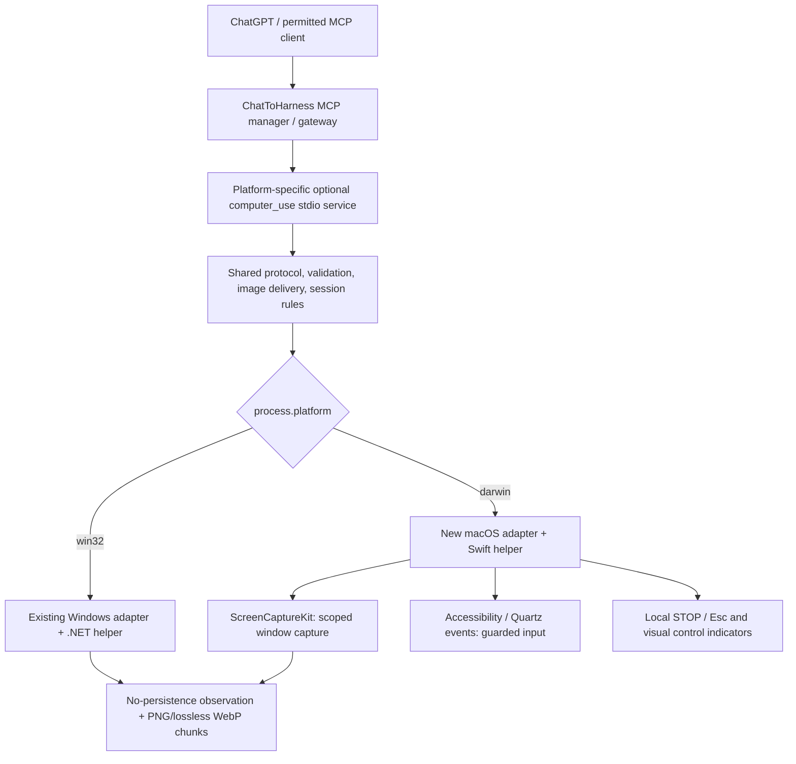

# macOS Computer Use — architecture and delivery plan

Date: 2026-10-20 (Asia/Shanghai)  
Status: **planned / M0 architecture review pending**. macOS runtime, accessibility permissions and native UI have **not** been implemented or tested.  
Priority: **P1, next cross-platform Computer Use feature after the Windows branch is stabilized**.  
Issue: **pending** — GitHub returned HTTP 410 (`Issues has been disabled in this repository`) when trying to create the corresponding task. Enable repository Issues first, then create/link the issue before beginning implementation.  
Dependency: Windows Computer Use baseline `feat/computer-use` (head at planning time: `772d7bf`).

## Scope and principles

Target the product's existing **macOS 14+ Apple Silicon (arm64)** release configuration. Add **window-scoped** observation and controlled input through an optional local stdio MCP service, compatible in semantics with the existing Windows `computer_use` tool. No desktop-wide screenshot fallback, unrestricted AppleScript/shell runner, TCC bypass, privilege escalation, or implicit approval of local MCP tools.

Reuse the current MCP manager's per-service trust and per-tool permissions, session routing/recovery, single-use fresh observations, bounded screenshots, lossless encoding, `read_screenshot` chunks/hashes, explicit close, and no-replay-on-error policy. Implement the platform-dependent part in a separately compiled macOS helper; do **not** fake support by dispatching the Windows .NET executable on Darwin.

Mac permissions are **additional** to ChatToHarness MCP authorization. The design must explain the distinction between macOS Screen Recording/Screen & System Audio Recording (wording differs by OS), Accessibility, and any input-monitoring permission required by the chosen global-stop interception mechanism. A denied or revoked permission must fail closed with explicit diagnostic codes.

## Proposed architecture



The adapter should be platform-specific **without making existing Windows installations change tool policy**. Initial implementation may expose a separate `macos-computer__computer_use` MCP alias. If unified names/configuration are chosen later, first document compatibility and migration impacts (a tool definition change can revoke previously granted permissions). Share an explicit schema/contract test suite rather than copying platform-specific security assumptions.

### Proposed Mac native APIs (validate on actual hardware)

| Concern | Candidate | Notes / acceptance gate |
| --- | --- | --- |
| Visible-window discovery | `SCShareableContent` / `SCWindow`; process identity via native app/window APIs | Ignore our own overlay/STOP windows, stale/off-screen windows, and secure/system UI. Do not treat windowID alone as enduring authorization. |
| Capture a single selected window | `SCContentFilter(desktopIndependentWindow:)` + `SCStream` | Check macOS 14 compatibility, OS grant/restart behavior, protected/DRM content, no whole-desktop fallback. |
| Identity, frontmost app, focus | Native process/window identity and Accessibility (`AXUIElement`) | Revalidate PID/window identity, foreground and geometry immediately before each input, deny stale or misdirected inputs. |
| Mouse, key and scroll | `CGEvent` and Accessibility where appropriate | No arbitrary key injection or clipboard access. Unicode input, user-active modifiers and race safety need Mac acceptance. |
| Visible control | Transparent non-activating click-through `NSPanel`/overlay | Same soft light-blue window gradient, **silhouette-accurate real-pointer glow**, and prominent STOP. Hide on exit, target loss and permission revocation. |
| Emergency stop | `Esc` local shortcut, plus clickable STOP | Investigate active `CGEventTap` and macOS required grants. If Esc cannot be reserved reliably, **do not start autonomous control**; never silently drop the stop action. |
| Pixel mapping | AppKit points / CoreGraphics global desktop space / ScreenCaptureKit captured pixels | Verify Retina scale, multiple monitors, negative origins, menu/titlebar and display changes with screenshots and real clicks. |

Official API references:

- [ScreenCaptureKit / SCStream](https://developer.apple.com/documentation/screencapturekit/scstream)
- [ScreenCaptureKit / SCContentFilter](https://developer.apple.com/documentation/screencapturekit/sccontentfilter)
- [Accessibility / AXUIElement](https://developer.apple.com/documentation/applicationservices/axuielement_h)
- [CoreGraphics / CGEvent and event taps](https://developer.apple.com/documentation/coregraphics/cgevent)

## Milestone plan

### M0 — contract, threat model and feasibility (**next**)

- [ ] Reconcile Windows tool inputs/outputs with a platform-neutral contract; enumerate unavoidable Darwin differences and stable aliases.
- [ ] Test ScreenCaptureKit scoped capture and native window listing on an **actual macOS 14+ arm64 Mac**; record permission prompts/restart requirements.
- [ ] Prove or reject Esc interception as a reliable, local, out-of-band stop before allowing input control; document safe fallback when unavailable.
- [ ] Write an ADR for Mac authorization (OS TCC **and** MCP policy), input race risks, supported/unsupported desktop states and overlay behavior.
- [ ] Define two-platform deterministic fixture protocol and Windows nonregression gates.
- [ ] Close M0 only with a signed-off ADR and feasibility evidence. **No implementation is claimed complete by this plan.**

### M1 — Mac enumeration and observation

- [ ] Build standalone signed-or-explicitly-documented Swift helper with typed line-delimited IPC (`shell:false`).
- [ ] Provide window list, user-visible consent and bound session open/recovery/close.
- [ ] Capture a single window at native pixel resolution and validate window movement, resizing, target identity and multi-display transforms.
- [ ] Use existing PNG/lossless WebP decision, snapshot size limits, SHA-256, repeatable chunks and no screenshot files.
- [ ] Test revoked/denied Screen Recording grants, protected windows and owner-process death.

### M2 — guarded input and visual affordances

- [ ] `activate`, `click`, `scroll`, `type_text`, bounded `key_press` with fresh one-use observation and target/foreground checks.
- [ ] Independent STOP and Esc, timeout, permission-revocation cleanup, no input replay, no unintended modifier state.
- [ ] Soft blue selected-window perimeter and accurate live pointer-silhouette glow, both click-through and removed on close.
- [ ] Verify observable UI feedback without polluting the scoped screenshots or intercepting target clicks.

### M3 — packaging, docs, localized UX

- [ ] Stage Mac-native helper, MCP service and production dependencies only on `darwin`; leave Windows C# build/resource staging intact.
- [ ] Provide `scripts/build-computer-use-macos.*` and `scripts/test-computer-use-macos.*` one-command build/acceptance flows usable on macOS without Windows tooling.
- [ ] Integrate with existing macOS arm64 DMG pipeline, check signing / notarization assumptions and TCC permission identity; do not claim notarization before it is performed.
- [ ] Update Chinese/English/Japanese user instructions, grant recovery, cancellation behavior and troubleshooting.

### M4 — real Mac acceptance + release decision

- [ ] Test own disposable GUI fixture with capture, Unicode, click, scroll, close, Esc, overlay, timeout, loss-of-focus, move/resize, multi-monitor/Retina.
- [ ] Exercise denied/revoked TCC, Secure Input/accessibility restrictions, logout/lock and window destruction. Mark unsupported cases explicitly, not as success.
- [ ] Verify process exit cleanup, stop during active input, stale observations, image chunk recombination/sha256, no screenshot persistence.
- [ ] Run Windows contract/native fixture tests again. Preserve Windows behavior and local Windows standalone MCP alias.
- [ ] Record Mac hardware/OS version, command, exit code and screenshots in `docs/evidence/`; update `docs/dev.md`, issue checklist, branch/commit and PR status. Only then mark macOS Computer Use **available**.

## UX contract sketch

```text
┌─ Light-blue translucent highlight around SELECTED native window ─┐
│  Native app content                                               │
│                 [real macOS cursor with contour glow]              │
└───────────────────────────────────────────────────────────────────┘
  ChatToHarness controls this window · Esc to stop · [STOP]
```

The outline is a local visual safety indicator, not a claim that OS-injected events are an atomic window sandbox. The mouse glow follows the shape/hotspot of the actual native cursor (no click-location ring or centered disk). The separate STOP is visible and operable without the target window gaining unintended input.

## Platform acceptance matrix

| Gate | Windows | macOS |
| --- | --- | --- |
| Shared session/API and tool permission | existing | planned |
| Window-bound screenshot / compressed chunks | existing | planned, Mac proof needed |
| Fresh-observation guarded click/text/key/scroll | existing | planned, Mac proof needed |
| Local STOP / Esc / visual indicators | existing | planned, Mac proof needed |
| OS permissions / revocation and secure desktop/input | Windows-specific | **mandatory** Mac proof |
| Build/package smoke and real installed app | Windows local preview | not started |
| Multi-display/Retina calibration | Windows DPI tests | **mandatory** Mac proof |

## Immediate backlog and issue blocker

- [x] 2026-10-20: read current Windows implementation, platform build routing and current product macOS arm64 target.
- [x] 2026-10-20: create the plan and explicit phase/gate matrix.
- [ ] Enable Issues on `watermoon/ChatToHarness` (repository setting; **not changed by this task**).
- [ ] Create issue titled `feat(computer-use): macOS 14+ 原生窗口控制与跨平台适配`; sync this milestone checklist and link the issue here and in `docs/dev.md`.
- [ ] Review and approve M0 ADR on a Mac; begin M1 only after M0 passes.
